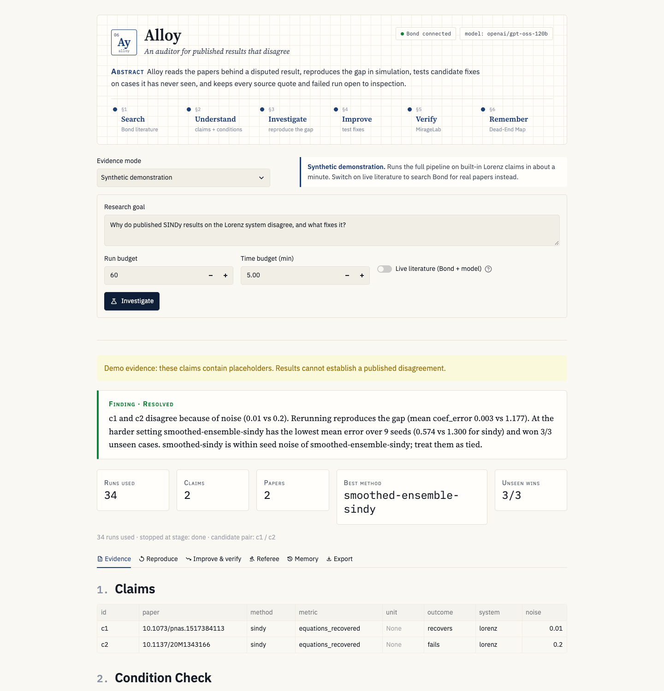

# Alloy

Alloy audits answers about why published results disagree. An AI agent can find a likely cause in a handful of runs. Alloy checks that answer: it reruns each paper's setting, tests one condition at a time, compares methods on fixed seeds, tries cases neither paper covered, and writes a report a reviewer can rerun line by line. Ganesh and Santosh are building it for the OSI Hackathon Boston (October 2026), with the Valency Bond MCP as the literature source.



A researcher gives Alloy a goal, a supported simulator and a compute budget. Alloy returns an `audit.md` with:

- the claims, with the conflicts it set aside and why
- a reproduction of each paper's result
- the error each differing condition adds, or the unstated setting that reproduces the gap
- a controlled comparison with standard errors, and a warning when two methods are tied
- the winner's results on unseen cases
- a replay notebook and a log of what failed

## Why an auditor

We first set out to show that Alloy finds good method combinations with fewer experiments than a plain agent. Our own benchmark says no: on five scenarios, Claude Sonnet 5.5 found every cause in 4 to 14 runs, against Alloy's 17 to 45 (details below). Speed is not where Alloy helps. It helps with trust: the agent's answer comes from a few lucky seeds and its prior knowledge, while Alloy's comes with controlled evidence you can replay. In the short_record audit, both named the same method, and Alloy added that the runner-up sits within seed noise of it.

## Quick start: no keys needed

Needs Python 3.11+ and [uv](https://docs.astral.sh/uv/).

```bash
git clone https://github.com/santoshnymbl/alloy.git && cd alloy
uv sync
uv run streamlit run ui/app.py   # open http://localhost:8501 and press Investigate
```

The default **Synthetic demonstration** runs the whole pipeline locally in about a minute: no
account, API key or network call. The same run from the terminal:

```bash
uv run alloy demo     # 34 simulations, writes runs/<id>/audit.md and replay.ipynb
uv run pytest -q
```

Offline mode reads synthetic claims in `data/seed/lorenz_claims.json`. Their placeholder
quotations are labeled in the UI and are not evidence of a published disagreement.

The UI has four modes:

| Mode | What it does | Needs |
|---|---|---|
| Synthetic demonstration | Full pipeline on seed claims; toggle **Live literature** to search Bond instead | nothing (live: keys below) |
| Reviewed literature | Shows reviewed primary papers and why each cannot yet be reproduced exactly | nothing |
| Collection campaign | Plans and runs up to three discrepancies under one shared budget | nothing |
| Saved investigation / campaign | Opens an exported JSON without rerunning anything | nothing |

## Live literature: free keys

Live mode searches real papers through Bond and uses an LLM to extract claims, pick methods
and referee the verdict. Both services have free tiers; nothing here needs a paid account.

1. **Model.** Create a free key at [console.groq.com](https://console.groq.com/keys). Alloy
   defaults to `openai/gpt-oss-120b` through Groq's OpenAI-compatible API (free tier: 1,000
   requests and about 200k tokens a day). Any OpenAI-compatible endpoint works through
   `ALLOY_LLM_BASE_URL`; set `ALLOY_MODEL` to a `claude-*` model and `ANTHROPIC_API_KEY` to use Claude.
2. **Bond.** Sign in to Valency's MCP server (`https://mcp.valency.io/`) with any MCP client
   that supports OAuth, and copy the access token, refresh token and client ID. Alloy calls Bond
   over HTTP and renews the token itself when it expires. Alternatively set
   `ALLOY_BOND_BACKEND=codex` to reuse an existing `codex mcp login valency`.
3. Copy `.env.example` to `.env` and fill in `GROQ_API_KEY` and the `VALENCY_*` values.

```bash
uv run alloy check                       # model, Bond backend, whether Bond is configured
uv run alloy bond-check                  # lists Bond's tools; no model call
uv run alloy bond-search "sparse identification of nonlinear dynamics Lorenz noise" --limit 5
uv run alloy demo --online --referee     # search, extract, investigate, referee
```

`bond-search` caches raw results and abstracts in `cache/`. Abstracts are not full-text
evidence of a disagreement, missing passages stay missing, and network or sign-in failures
exit with an error rather than substituting demo papers. Extracted quotes are snapped to the
source sentence they came from, and claims whose quote is not in the source are dropped.

`uv run alloy audit --scenario short_record` runs a plain agent on the configured model and
compares its cause and method with Alloy's investigation, adding a "second opinion" table to
the report.
In the app, the Referee tab of a saved investigation has the same check ("Ask a plain agent"),
behind the live passcode in public mode, and the report download adds BibTeX references
from Bond when Bond is configured.

### Hosting a public copy

The app runs on [Streamlit Community Cloud](https://share.streamlit.io) for free. Deploy
`santoshnymbl/alloy`, branch `main`, main file `ui/app.py`, Python 3.11 or later; Cloud installs
from `uv.lock`. Add these secrets in the app settings (TOML, one per line):

```toml
GROQ_API_KEY = "..."
ALLOY_PUBLIC = "1"              # caps budgets at 120 runs and 10 minutes
ALLOY_LIVE_PASSCODE = "..."     # optional; visitors need it only for live literature
ALLOY_LIVE_RUNS_PER_DAY = "40"  # shared by every visitor
```

Synthetic, reviewed and saved modes need only the model key. Live literature also needs the
`VALENCY_*` values. Valency rotates refresh tokens on every renewal, so give the hosted copy
its own sign-in: a refresh token shared with a laptop stops working on whichever side renews
second. The hosted cache is wiped on restart, after which the stored refresh token is stale
and live mode needs a new sign-in.

### Audit a collection under one budget

```bash
uv run alloy campaign --synthetic data/seed/collection_claims.json --plan-only
uv run alloy campaign --synthetic data/seed/collection_claims.json --runs 60 --minutes 5
uv run alloy campaign --evidence data/evidence/sindy_review.json --plan-only
```

The planner accepts at most 20 canonical works and 100 claims, screens every pair,
and queues up to three discrepancies with visible ranking reasons. One run/time
budget covers the entire queue. Failed simulations count; insufficient budgets
leave pairs deferred, and uncertain accounting stops further launches. The current
campaign supports Lorenz/PySINDy; coatings remains a separate command. Every
conclusion applies to its own pair. See the [implementation contract](docs/multi-paper-implementation.md)
and [acceptance ledger](docs/multi-paper-handoff.md).

### Reviewed literature

`data/evidence/sindy_review.json` contains four reviewed primary sources, source locations,
short excerpts, stated settings and explicit reproduction gaps.

**A real disagreement.** Brunton et al. 2016 recover the Lorenz equations from noisy data;
Kaheman et al. 2020 report that the same original SINDy fails above 8% noise. Running both
protocols shows that noise placement decides it: on Brunton's own record, moving the noise from
the derivatives to the states turns recovery into failure on every seed. Read as a
standard-deviation ratio, Kaheman's "8%" lands near the limit the probe finds; read as the
variance ratio their Eq. 19 defines, SINDy already fails from 1%. With five datasets the curve is
not monotonic, so the probe does not pin the limit down. Details and caveats:
[real-pair-review.md](docs/real-pair-review.md); rerun with `uv run python scripts/real_pair_probe.py`.

The pair is still **not eligible for exact reproduction**: neither paper states every setting
(thresholds, derivative construction), so those runs use labeled assumptions. `alloy demo
--evidence <bundle>` validates the bundle and refuses to run when no eligible pair exists. It
never substitutes synthetic claims. `uv run alloy evidence-check` lists the blockers per paper.

If a native MCP client already returned a search response, import it with
`uv run alloy bond-import /path/to/result.json --query "the exact original query" --limit 5`.

### Real paper pair, end to end

`uv run alloy real-pair` (or **Real paper pair** in the app) audits Brunton 2016 against Kaheman 2020
with no keys, in about a minute:

1. **Bond** confirms both papers (`export_papers_json`) and checks that a semantic search finds them.
   Bond returns metadata and abstracts only. We tested all 38 tools on 12 papers across five sources.
2. **arXiv HTML** (`arxiv.org/html/<id>`) supplies the full text with sections and tables. Alloy keeps
   only the methods, results and table sections, about 3,000 tokens a paper, so Groq's free tier
   can read it.
3. **The model extracts stated settings only**, each with a quote. Code keeps a setting only if its
   quote is in the text and the quote supports the value. Extraction ran on GPT-OSS-120B through Groq.
4. **Code fills gaps by rule:** the other paper's stated value, else the adapter default. Noise
   placement and derivative construction are never borrowed, because they are the likeliest causes.
   An unstated threshold means "recovered if any of 8 thresholds works", the rule Kaheman et al. use.
5. **Readings.** An ambiguous noise unit becomes labelled readings, with the paper's own definition
   tried first.
6. **Tiers.** Each paper is `exact`, `reproduced under assumptions` or `not reproduced`. If a run
   does not match the reported outcome, Alloy tries the other readings, then varies one assumed
   setting at a time, with a cap of 8 variants.
7. **Cause.** Alloy flips each group of settings (noise level, noise placement, record, library,
   regression) from the recovering paper to the failing one and measures the drop in recovery.
   Locally it also runs the reverse flip.

Result (22 Oct 2026, 152 runs): both papers reproduce under labelled assumptions. Moving Brunton's
noise placement to Kaheman's (state noise with finite differences) drops recovery from 3 of 3
seeds to 0. Noise level drops it to 2 of 3, and the record and library change nothing. That
matches the hand-checked answer in `docs/real-pair-review.md`.

Caveats:

- **This is one scored pair.** Brunton–Kaheman is the only pair with a hand-checked answer, so the
  real-paper bench has n = 1.
- **Two outcomes are reviewer-read.** Neither paper states its outcome in prose. Brunton's comes from
  Table 4 and Kaheman's from the Figure 14 image. `data/literature/reviewed_outcomes.json` records
  both with their locators, and the report labels them.
- **Committed settings, not full text.** `data/literature/protocols/` holds the verified settings and
  short quotes, so judges can rerun without a model key or network. Use `--fresh` to extract again,
  and `--save` to commit a new reviewed extraction.
- **A second pair failed honestly.** Brunton against Weak SINDy (`alloy real-pair arxiv:1509.03580
  arxiv:2005.04339`) stops because Weak SINDy's text states no outcome for standard SINDy, so there
  is nothing to reproduce. A reviewer can add one from its figures.

### Replay

Every run folder holds a notebook that reruns its experiments:

```bash
uv run jupyter nbconvert --to notebook --execute runs/<id>/replay.ipynb --output executed.ipynb
```

On 21 Oct 2026 a demo run's 34 experiments replayed with identical metrics.

## The loop

| Stage | What runs | Code |
|---|---|---|
| 1 Search | Bond over HTTP (OAuth token) or Codex OAuth, cached to `cache/` | `knowledge/bond.py`, `knowledge/http_bond.py` |
| 2 Understand | Claim extraction and the evidence graph | `knowledge/extract.py`, `knowledge/graph.py` |
| 3 Investigate | Condition Check, then a rerun at each claim's conditions | `knowledge/conditions.py`, `agent/loop.py` |
| 4 Improve | Method search, then a controlled comparison | `knowledge/methods.py`, `experiments/compare.py` |
| 5 Verify | MirageLab: unseen start points and noise levels | `experiments/verify.py` |
| 6 Remember | Dead-End Map, replay notebook and audit report | `memory/deadend.py`, `experiments/export.py`, `experiments/report.py` |

`agent/loop.py` wires the stages together. `agent/referee.py` argues against the final verdict.

## First demo: equations from noisy data

The physics task recovers the Lorenz equations with PySINDy. The seed claims say plain SINDy recovers the equations at low noise and fails at high noise. Alloy reruns both, compares smoothing, ensembling and their combination under one budget, and checks the winner on three unseen cases.

The seed claims hold placeholder quotes. Keep them labeled as synthetic in a demo.
Reviewed literature must pass the evidence-bundle checks before it can replace this input;
retrieving a DOI or an abstract does not establish the reported number or its settings.

## Second task: radiative cooling coatings

`uv run alloy coatings --layers 3 --tolerance 30` compares three designs for a coating on a silver mirror: one SiO2 emitter, the best of 12 random TiO2/SiO2 stacks, and the same search scored under thickness errors. The adapter uses the transfer-matrix method (`tmm`) with approximate optical constants listed in `experiments/data/optics.py`. It omits silver's UV interband absorption, so it underestimates solar absorption. Swap in measured data before trusting a number.

First run (3 layers, 30 nm thickness error): the single 1 um SiO2 layer cools 47 W/m^2 and loses the race after 2 seeds. Both searched stacks cool about 85 W/m^2 out of an ideal 148 W/m^2, and they tie under thickness errors (0.422 vs 0.426 cooling error, standard error about 0.01). A 30 nm error on micron-thick layers changes little. A sharper test needs thinner, resonant layers.

## Benchmark: Alloy vs a plain agent

`uv run alloy bench` runs both systems on the scenarios in `data/scenarios/` with the same claims, simulator and 60-run budget. All scenarios are synthetic and say so in their files.

| Scenario | What makes it hard |
|---|---|
| noise_simple | Nothing: one condition differs |
| noise_with_decoys | Three conditions differ; only noise matters |
| short_record | Three conditions differ; only record length matters |
| hidden_threshold | Both papers state the same conditions; one used a threshold it never reported |
| many_papers | Ten claims; three conflicts are traps (different system, different units, unsupported method) |

An oracle measures every method on 10 seeds that neither system sees. Each system scores on three things: whether it names the right cause, whether its recommended method is within 10% (or 0.02) of the oracle's best, and how many runs it used. Add `--alloy-only` to skip the plain agent and its API calls.

Results on 21 Oct 2026. Alloy runs once per scenario because its offline run is deterministic. The plain agent ran 5 times per scenario on Claude Sonnet 5.5 (`--repeat 5`, about 284k input and 46k output tokens in total).

These are upstream historical results, not reruns of this branch. They predate the baseline
prompt correction that supplies every Claim field, including units, zero values and source
quotations. The units-trap comparison therefore needs reevaluation with equal information.
No updated efficiency or superiority claim is established here; paid reruns were not performed.

| Scenario | Alloy cause / answer / runs | Plain agent (Sonnet 5.5, n=5) cause / answer / mean runs |
|---|---|---|
| noise_simple | 1/1 / 1/1 / 34 | 5/5 / 5/5 / 4.0 |
| noise_with_decoys | 1/1 / 1/1 / 43 | 5/5 / 5/5 / 4.4 |
| short_record | 1/1 / 1/1 / 45 | 5/5 / 5/5 / 13.8 |
| hidden_threshold | 1/1 / no method question / 17 | 5/5 / no method question / 12.4 |
| many_papers | 1/1 / 0/1, flagged as a tie / 41 | 5/5 / 0/5 / 7.4 |

**Rerun on the free model (21 Oct 2026).** One plain-agent run per scenario on GPT-OSS-120B
through Groq's free tier. The short_record run first stopped at Groq's token limit and was rerun
on 22 Oct through `alloy audit`. One run per scenario is an anecdote, not a rate.

| Scenario | Alloy cause / answer / runs | Plain agent (GPT-OSS-120B, n=1) cause / answer / runs |
|---|---|---|
| noise_simple | right / right / 34 | noise, right / smoothed-sindy, right / 20 |
| noise_with_decoys | right / right / 43 | noise, right / smoothed-ensemble-sindy, right / 19 |
| short_record | right / right / 45 | t_end, right / smoothed-ensemble-sindy, right / 20 |
| hidden_threshold | right / no method question / 17 | outliers, wrong / no method question / 20 |
| many_papers | right / wrong, flagged as a tie / 41 | sparsity threshold, wrong / smoothed-ensemble-sindy, right / 19 |

On the free model the plain agent named the wrong cause twice: it blamed outlier noise when
the hidden setting was the threshold, and the threshold when the cause was noise. Alloy's
offline loop does not use the model, so its column matches the Sonnet table.

An earlier single-run pass with Claude Opus 5.5 as the plain agent used 17 to 35 runs per scenario and once took the units trap in many_papers. Sonnet 5.5 never took the trap in 5 runs.

What the numbers say:

- With Sonnet 5.5 the plain agent matches Alloy on every cause and every answer, and uses 3 to 10 times
  fewer runs. With the free GPT-OSS-120B it missed two of four causes (n=1 each).
- In noise_simple and noise_with_decoys, Sonnet named noise after about 4 runs without testing the decoy conditions. Its prior knowledge that noise breaks SINDy solves these scenarios. They test textbook knowledge more than investigation.
- Both systems miss the many_papers answer the same way. Alloy now races methods: it drops a method once it trails the leader by more than two combined standard errors and adds seeds to the rest, up to 9. After 9 seeds smoothed-sindy still leads (0.052 vs 0.066), so Alloy's verdict calls the two tied. The plain agent picks one without a warning.
- On these scenarios the data do not support the claim that Alloy finds good combinations with fewer experiments.

What would test the claim properly:

- Scenarios where the cause runs against textbook intuition, so prior knowledge misleads the agent.
- Real papers from Bond, where conditions sit in prose and many claims do not line up.
- An adaptive Alloy comparison that stops testing clear losers early and adds seeds only when two methods are close.

## Contracts

Both lanes build against `src/alloy/contracts.py`. The knowledge code writes `Claim` and `ExperimentSpec`. The experiment code reads specs and writes `RunResult`. Agree on any change to that file before you push it.

## Who owns what

| Area | Owner |
|---|---|
| `knowledge/` (Bond, claims, graph, Condition Check, method search), `ui/` | Ganesh |
| `experiments/` (adapters, runner, comparison, MirageLab, export), `agent/` | Santosh |
| `contracts.py`, `agent/baseline.py`, the demo | Both |

## Open work

- [x] Native-session Bond search, raw-result ingestion, deduplication and cache replay
- [x] Live Bond search over HTTP with token renewal; claim extraction on free Groq GPT-OSS-120B
- [x] Review a real-paper disagreement (Brunton 2016 vs Kaheman 2020) and run both protocols
- [ ] An eligible real-paper pair: needs papers that state every setting, including thresholds
- [x] Baseline prompt includes every Claim field; historical results still need fair reruns
- [x] `experiments/adapters/tmm_adapter.py`: cooling coatings (stretch)
- [x] UI: condition differences, citation trail, saved records and failure history
- [x] Bounded collection planner, shared-budget campaign records and saved campaign UI
- [x] Research-style Streamlit UI
- [x] GPT-OSS-120B plain-agent rerun on all 5 scenarios (n=1 each; repeats would make it a rate)
- [ ] Public Streamlit Cloud deployment (public-mode guards ready; needs a sign-in at share.streamlit.io)
- [ ] Record the backup demo video from cached runs

## Adding a scientific task

Write an adapter with `name`, `task`, `methods`, `condition_keys` and `run(spec) -> (metrics, artifacts)`, call `register()`, and import it in `experiments/adapters/base.py`. Name lower-is-better metrics with an `_error` suffix.
